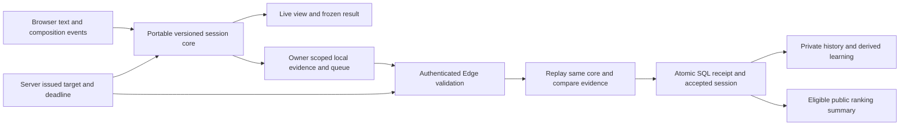

# Typing Forge: accuracy, architecture and competitor research

Research date: **15 October 2026**. Scope: the user's pasted 30-second result, the current Forge implementation, official Monkeytype and Keybr source, and browser input specifications. This is a source-level engineering comparison, not a global popularity ranking, a controlled educational trial, a hardware review, or proof of any site's deployed production infrastructure.

## 1. What the pasted result actually establishes

The headline **86.5% input accuracy is arithmetically correct** for the displayed 135 correct insertion attempts out of 156. It measures the history of attempted input. The separate 92% measures the final retained/processed text. These are different questions, and correcting a mistake should improve final text without erasing the original mistake from input accuracy.

| Displayed quantity | Recalculation from the supplied numbers | Assessment |
| --- | --- | --- |
| Input accuracy | `135 / 156 × 100 = 86.5384615…%` | 86.5% is correct after presentation rounding |
| Incorrect attempts | `156 − 135 = 21` | Matches the explanation |
| Final accuracy | `136 / (136 + 10 + 1 + 1) × 100 = 91.8918919…%` | 92% is correct after whole-percent rounding |
| Retained characters | `136 correct + 10 incorrect + 1 extra = 147` | The missed slot has no retained character |
| Raw WPM | `147 / 5 / (30 / 60) = 58.8` | 59 is correct after whole-WPM rounding |
| Attempt rate | `156 / 5 / (30 / 60) = 62.4` | 62 is correct after whole-WPM rounding |
| Net edit balance | `156 inserted − 9 deleted = 147 retained` | Internally consistent for this result |
| Credited WPM | Depends on which complete words were correct, the final partial word and elapsed time | **44 cannot be independently verified from these aggregate counts alone** |
| Consistency 58% | Requires timestamped attempts and bucket durations | Not independently verifiable from the paste |
| Five-second burst 84 | Requires timestamped attempts and complete window boundaries | Not independently verifiable from the paste |
| 485 untyped | Generated future text that was not attempted before a timed cutoff | Correctly excluded from timed final accuracy |

Final correct characters can differ from correct insertion attempts. An attempt is judged against its expected position when it occurs; later selection edits, insertion or deletion can change the final alignment. Also, a correct attempt can subsequently be deleted. These counts are not interchangeable. Exact replay evidence is required to decide whether a particular event history was classified correctly.

For a 30-second duration, displayed whole-number WPM 44 does not uniquely identify the credited character count: rounding could hide a nearby value. Exported full-precision metrics plus the target and normalized event history are the appropriate audit input. A screenshot alone cannot prove event accounting or timing.

The local source of these definitions is [the Forge metric contract](./METRICS.md), `src/lib/typing-core/metrics.ts`, `transcript.ts` and `session.ts`. The current contract uses grapheme units, not an unqualified count of physical key presses.

## 2. Research method and reproducible upstream snapshots

Both official repositories were cloned read-only into the operating-system temporary directory; their dependencies were not installed and their code was not copied into Forge. Public web pages were checked, but the text-only fetches of the interactive Monkeytype About and Keybr Help pages did not expose their full rendered content. Concrete algorithm claims below therefore refer to pinned source files.

| Product | Official repository | Inspected commit | Commit timestamp |
| --- | --- | --- | --- |
| Monkeytype | [monkeytypegame/monkeytype](https://github.com/monkeytypegame/monkeytype) | `01545f4ff1c2a4a51aa84f081cc77e10254ad369` | 2026-10-15 16:18:36 +02:00 |
| Keybr | [aradzie/keybr.com](https://github.com/aradzie/keybr.com) | `05a37bc5265f65ff538c59c613db29442f345d51` | 2026-09-28 20:39:32 +02:00 |

These are public source snapshots. They do not prove which commit either public service currently deploys. Forge findings refer to this workspace during the implementation turn; later changes should update its metric contract and tests together.

Monkeytype's repository license is GPL v3; Keybr's license file is AGPL v3. Product behavior and mathematical definitions can inform an independent design. Reusing their implementation or content requires a separate license review. This report does not import either codebase. Sources: [Monkeytype license](https://github.com/monkeytypegame/monkeytype/blob/01545f4ff1c2a4a51aa84f081cc77e10254ad369/LICENSE), [Keybr license](https://github.com/aradzie/keybr.com/blob/05a37bc5265f65ff538c59c613db29442f345d51/LICENSE).

## 3. Formula comparison: the same label can mean different measurements

### Monkeytype

The current result builder calculates WPM from credited correct-word characters, raw WPM from final correct/incorrect/extra characters, and accuracy from input-event outcomes. The reported character array's first entry is **credited correct-word characters**, while the separate `charTotal` uses all retained correct characters. Thus even apparently similar character summaries should not be assumed identical to Forge. Sources: [result construction](https://github.com/monkeytypegame/monkeytype/blob/01545f4ff1c2a4a51aa84f081cc77e10254ad369/frontend/src/ts/test/test-logic.ts#L734-L836), [WPM utility](https://github.com/monkeytypegame/monkeytype/blob/01545f4ff1c2a4a51aa84f081cc77e10254ad369/frontend/src/ts/utils/numbers.ts#L153-L160).

Accuracy is `correct eligible input events / all eligible input events × 100`; corrected mistakes remain in event history. Its empty denominator returns zero. Deletion events do not themselves become incorrect character attempts. Full words must match exactly for word credit. A timed partial last word receives credit only when the typed partial is a prefix of the target. Sources: [accuracy/event reconstruction](https://github.com/monkeytypegame/monkeytype/blob/01545f4ff1c2a4a51aa84f081cc77e10254ad369/frontend/src/ts/test/events/stats.ts#L475-L590), [word accounting](https://github.com/monkeytypegame/monkeytype/blob/01545f4ff1c2a4a51aa84f081cc77e10254ad369/frontend/src/ts/utils/strings.ts#L417-L466).

### Keybr

Keybr's lesson statistics use **accepted target steps**, with a Boolean typo flag associated with a step. Its lesson accuracy is `(length − typo steps) / length`; time is the last accepted step timestamp minus the first. Lesson speed is characters per minute, converted to WPM with a factor of one fifth. Repeated wrong input before recovering one target position does not create the same denominator as Forge's all-insertion-attempt policy. Sources: [lesson statistics](https://github.com/aradzie/keybr.com/blob/05a37bc5265f65ff538c59c613db29442f345d51/packages/keybr-textinput/lib/stats.ts), [result definitions](https://github.com/aradzie/keybr.com/blob/05a37bc5265f65ff538c59c613db29442f345d51/packages/keybr-result/lib/result.ts), [speed units](https://github.com/aradzie/keybr.com/blob/05a37bc5265f65ff538c59c613db29442f345d51/packages/keybr-result/lib/speedunit.ts).

Its input processor holds error state and recovery input separately. Correcting or forgiving an error can advance the target while preserving that position's typo flag; optional word skipping synthesizes missed target steps. Therefore Keybr accuracy is neither a simple final-text equality score nor a universal per-physical-keystroke score. Source: [Keybr text input state machine](https://github.com/aradzie/keybr.com/blob/05a37bc5265f65ff538c59c613db29442f345d51/packages/keybr-textinput/lib/textinput.ts).

### Forge

| Dimension | Monkeytype public source snapshot | Keybr public source snapshot | Forge metric contract at research baseline |
| --- | --- | --- | --- |
| Main purpose | Configurable speed tests and result history | Adaptive lessons and per-key learning | Testing, learning and practice/race evidence |
| WPM numerator | Exact-word credit; eligible final partial prefix | Accepted target-step length, with separate error count | Complete correct words and actually entered separators; timed last word's leading correct prefix |
| WPM denominator | Measured test duration; specific zen/bailout tail handling | First-to-last accepted step interval | Explicit active monotonic interval; idle included; declared pauses excluded |
| Raw WPM | Retained correct + incorrect + extra characters | Not the same main lesson score | Retained graphemes / 5 / minutes |
| Input accuracy | Eligible correct input events / eligible total input events | Correct target steps / target steps | Correct inserted graphemes / all inserted graphemes, including rejected and later deleted mistakes |
| Final accuracy | Detailed final character categories available; not Forge's separate hero formula | Error recovery drives step status | Correct / (correct + incorrect + extra + applicable missed) |
| Backspace | Correction time remains; prior wrong input remains in accuracy history | Error-buffer/word-clear semantics; typo state retained | Separate deletion operations/units; no insertion denominator penalty for the delete action |
| Empty denominator | Accuracy zero in inspected helper | Empty/insufficient stats zero | Unknown accuracy is null, displayed unavailable |
| Unicode units | Some string paths iterate UTF-16 units; additional language/IME special cases | Code-point-oriented target/input model | Unicode grapheme segmentation, identified by policy/version |
| Comparability | Mode, duration, language, options and result eligibility matter | Layout family, lesson type and learning target matter | Explicit generated comparison key containing metric and content policy dimensions |

The Unicode observation is a source-level implementation distinction, **not evidence that one entire product is broken for a language**. Runtime, input method, normalization and script fixtures need browser testing. Monkeytype splits multi-character inserted strings in its input handler and also has special language normalization. Source: [Monkeytype insert-text handling](https://github.com/monkeytypegame/monkeytype/blob/01545f4ff1c2a4a51aa84f081cc77e10254ad369/frontend/src/ts/input/handlers/insert-text.ts#L131-L226).

Forge's partial-word policy diverges from Monkeytype when the final partial contains a later wrong letter: Forge credits the correct leading prefix, whereas the inspected Monkeytype helper requires the entire typed partial to be a target prefix. This is a deliberate policy comparison, not permission to silently change historical `forge-v3` results. If changed, introduce a new metric version, segregate personal bests and server acceptance, and preserve the original result.

## 4. Consistency, burst and graphs

Monkeytype takes per-interval insertion rates, computes their population standard deviation divided by their mean, and applies:

`100 × (1 − tanh(CV + CV³/3 + CV⁵/5))`

It also derives key-spacing consistency and cumulative-WPM consistency. The primary result's graph construction uses cumulative WPM, per-interval burst and error counts. Sources: [result and graph construction](https://github.com/monkeytypegame/monkeytype/blob/01545f4ff1c2a4a51aa84f081cc77e10254ad369/frontend/src/ts/test/test-logic.ts#L760-L837), [nonlinear mapping](https://github.com/monkeytypegame/monkeytype/blob/01545f4ff1c2a4a51aa84f081cc77e10254ad369/packages/util/src/numbers.ts#L35-L84), [interval rates](https://github.com/monkeytypegame/monkeytype/blob/01545f4ff1c2a4a51aa84f081cc77e10254ad369/frontend/src/ts/test/events/stats.ts#L255-L277).

Forge's current consistency is duration-weighted `clamp(100 × (1 − CV), 0, 100)` over one-second attempt buckets, including idle buckets, with a minimum of five seconds and five attempts. Its five-second burst is a complete five-second attempt window on a one-second grid plus the last window. Its raw graph is cumulative retained WPM. These are useful measurements, but they are **not numerically interchangeable** with Monkeytype's consistency or its per-interval burst graph.

Recommended display language: “Rhythm consistency” with its own formula, “5-second attempt burst,” “Raw speed: retained text,” and “Input pace: every insertion.” Keep the simple WPM/input-accuracy pair prominent. Put additional metrics and denominators in an expandable evidence section. Do not make a jittery single-second rate look like the user's final speed.

## 5. How adaptive learning really works

Keybr's guided lesson begins with at least six letters, uses target-speed confidence, supports current versus best historical confidence, focuses the weakest included letter, and can combine a filtered natural-word dictionary with phonetic generation. Alphabet-size, recovery and keyboard-order settings affect introduction. Its “confidence” is a target-time/measured-time ratio; it is **not a calibrated probability**. Sources: [guided lesson selection/generation](https://github.com/aradzie/keybr.com/blob/05a37bc5265f65ff538c59c613db29442f345d51/packages/keybr-lesson/lib/guided.ts), [confidence target](https://github.com/aradzie/keybr.com/blob/05a37bc5265f65ff538c59c613db29442f345d51/packages/keybr-lesson/lib/target.ts).

Per-key histograms count typo-marked steps, while qualified successful timings contribute to time-to-type. The trigger step is excluded from the histogram. Per-key aggregates smooth lesson samples; Keybr separately tracks current and best filtered timing. Sources: [histograms](https://github.com/aradzie/keybr.com/blob/05a37bc5265f65ff538c59c613db29442f345d51/packages/keybr-textinput/lib/histogram.ts), [per-key samples](https://github.com/aradzie/keybr.com/blob/05a37bc5265f65ff538c59c613db29442f345d51/packages/keybr-result/lib/keystats.ts).

Keybr's remaining-lesson estimate fits recent speed observations with a polynomial and reports an estimate only above an R² threshold of 0.5. This is an extrapolation with bounded look-ahead, not a guarantee of when someone will master a key. Source: [learning-rate estimation](https://github.com/aradzie/keybr.com/blob/05a37bc5265f65ff538c59c613db29442f345d51/packages/keybr-lesson/lib/learningrate.ts).

Forge already keeps learning dimensions separate by owner, language, layout, domain and input method. It requires recent evidence, accuracy and multiple dedicated assessment checkpoints, distinguishes introduced from mastered keys, and excludes unknown/composition timing from individual-key latency. These are product-policy choices to validate with actual learning outcomes, not a claim of scientific superiority over Keybr.

The strongest next improvement is explainable practice selection: “You made 4 errors on `r` in 17 attempts; practise these words, then repeat the passage.” Show insufficient samples neutrally. Compare within the same language/layout/input mode and content policy. Report repeated-passage gains separately from unseen-content gains. Never manufacture a percentile or “AI confidence” number from a tiny sample.

## 6. Architecture: what to adopt and what cannot be inferred

### Monkeytype's public architecture

The official monorepo separates frontend, backend, shared contracts/schemas and utilities. It uses a TypeScript frontend with Solid components and a Node/Express backend; package and repository metadata identify Firebase, MongoDB and Redis integrations. That describes the public code, not the production topology, capacity, uptime or operating costs. Sources: [official README](https://github.com/monkeytypegame/monkeytype/blob/01545f4ff1c2a4a51aa84f081cc77e10254ad369/README.md), [backend dependencies](https://github.com/monkeytypegame/monkeytype/blob/01545f4ff1c2a4a51aa84f081cc77e10254ad369/backend/package.json).

The result controller checks authenticated context, minimum test requirements, eligible accuracy, result timing/duplicates, key timing and feature/PB conditions before storage. Its anti-cheat calls point to a **public placeholder** whose validation functions warn and return true; production starts are restricted unless a real module or explicit bypass is supplied. It would be inaccurate to claim that the public repository reveals the deployed anti-cheat algorithm. Sources: [result controller](https://github.com/monkeytypegame/monkeytype/blob/01545f4ff1c2a4a51aa84f081cc77e10254ad369/backend/src/api/controllers/result.ts), [public anti-cheat placeholder](https://github.com/monkeytypegame/monkeytype/blob/01545f4ff1c2a4a51aa84f081cc77e10254ad369/backend/src/anticheat/index.ts).

### Keybr's public architecture

Keybr is an open-source TypeScript monorepo with React UI, a Node server, database models and purpose-specific lesson/input/result packages. Its server uses Fastr middleware/controllers, session-based authentication and Knex/Objection database integrations. The documented development flow can use SQLite. Sources: [package dependencies](https://github.com/aradzie/keybr.com/blob/05a37bc5265f65ff538c59c613db29442f345d51/package.json), [development instructions](https://github.com/aradzie/keybr.com/blob/05a37bc5265f65ff538c59c613db29442f345d51/docs/getting_started.md), [authentication middleware](https://github.com/aradzie/keybr.com/blob/05a37bc5265f65ff538c59c613db29442f345d51/packages/server/lib/app/auth/middleware.ts).

Its sync controller authenticates personal writes, bounds uploaded binary data, parses and validates results, appends user history and updates high scores. There is also a public-profile history route. Result storage uses binary files with cache validators in the inspected `UserData` implementation. A delete operation renames the history file to a backup suffix; this source path alone does not establish a service-wide erasure/retention policy. Sources: [sync controller](https://github.com/aradzie/keybr.com/blob/05a37bc5265f65ff538c59c613db29442f345d51/packages/server/lib/app/sync/controller.ts), [user result file handling](https://github.com/aradzie/keybr.com/blob/05a37bc5265f65ff538c59c613db29442f345d51/packages/keybr-result-userdata/lib/userdata.ts).

### Forge's architecture and the integrity boundary

The local browser should own responsiveness and provisional practice feedback. The server should own identity, challenge issuance, deadlines, immutable accepted results, eligibility, race membership and atomic effects. Reusing a portable core avoids two metric implementations drifting apart. A digest identifies an unchanged payload; it does not prove human origin. Client timestamps, a browser's `isTrusted`, a nonce, and a plausible WPM ceiling do not together prove that a human typed a result.

Forge includes this separation in source. Its migrations, row policies, idempotent receipt logic, durable queue and Edge functions still need a real staged Supabase deployment with independent authenticated clients and concurrency tests. A PostgreSQL/WASM fixture does not verify hosted Auth, API, Realtime, scheduler installation or network race ordering. See [data and deployment gates](./DATA_AND_DEPLOYMENT.md).

## 7. Error modes: define behavior instead of using vague strictness labels

| Mode | User experience | What must still be measured |
| --- | --- | --- |
| Natural editing | Wrong characters appear; user can correct or continue | Every original insertion, later deletion, retained result and elapsed time |
| Reject wrong character | Cursor stays until the correct character is entered | Rejected attempts stay errors; no invisible score improvement |
| Require correct word before advance | Cannot leave a word with remaining mistakes | Incorrect attempts and correction time remain in history |
| Fail on first error | Attempt ends immediately on a wrong character | Failed status; no comparable completed timed PB |

Monkeytype's Master setting fails on an incorrect input; Expert fails when committing an erroneous word. Its stop-on-letter option removes/rejects the last incorrect character while still accounting for the incorrect attempt. Sources: [difficulty checks](https://github.com/monkeytypegame/monkeytype/blob/01545f4ff1c2a4a51aa84f081cc77e10254ad369/frontend/src/ts/input/helpers/fail-or-finish.ts#L38-L73), [stop-on-letter handling](https://github.com/monkeytypegame/monkeytype/blob/01545f4ff1c2a4a51aa84f081cc77e10254ad369/frontend/src/ts/input/handlers/insert-text.ts#L232-L245).

Keybr explicitly describes stop-on-error as waiting for the right key **without requiring Delete**. Its forgiveness and word-skip settings change recovery. Source: [input settings documentation](https://github.com/aradzie/keybr.com/blob/05a37bc5265f65ff538c59c613db29442f345d51/packages/keybr-textinput/lib/settings.ts#L14-L69).

Offer strict modes as preferences, with a clear label and separate comparison policy. Do not assert that typing past a mistake necessarily “cements” a harmful motor memory: the inspected implementation sources do not establish that causal educational claim. A 98% accuracy target can be a configurable goal; it is not a universal scientific threshold or a guarantee of future accuracy.

## 8. Keyboard detection: useful assistance with explicit limits

`KeyboardEvent.code` indicates a physical-key position independently of the current character mapping. `KeyboardEvent.key` indicates the produced key value and depends on layout/modifiers. Virtual or accessibility input may be represented with browser-supplied compatible values, so these fields are not proof of physical hardware. Source: [UI Events keyboard specification](https://www.w3.org/TR/uievents/#events-keyboardevents), [MDN code semantics](https://developer.mozilla.org/en-US/docs/Web/API/KeyboardEvent/code).

`navigator.keyboard.getLayoutMap()` can provide key-position labels in supporting secure contexts. It is not broadly available, may fail under permissions policy, and the specification's ASCII-capable mapping rules mean it should not be treated as a complete detector of the active IME or every native script. Sources: [Keyboard Map specification](https://wicg.github.io/keyboard-map/), [MDN API compatibility and security notes](https://developer.mozilla.org/en-US/docs/Web/API/Keyboard/getLayoutMap).

Recommended flow:

1. Provide an explicit “Check my layout” action in keyboard setup.
2. Feature-detect the map API; catch refusal, empty/ambiguous maps and unsupported environments.
3. Suggest a layout from the returned position/label evidence. Show “Suggested,” with manual confirmation and correction.
4. If unavailable, offer manual layout selection and a short optional key-position check. Do not guess from the user's browser language alone.
5. Keep layout selection out of a running scored session. Version any subsequent change and keep its comparisons separate.
6. Capture typing only while the exercise is focused; avoid global logging, hidden device fingerprinting or unrelated passage collection.

A normal typing website cannot reliably identify switch type, actuation force, ergonomic geometry, brand, firmware debounce or actual end-to-end input latency from text events. WebHID is permission-gated, device-specific and browser-limited; Chrome protects generic keyboard/mouse report collections. It is not a universal hardware detector. Sources: [WebHID interfaces and permissions](https://developer.mozilla.org/en-US/docs/Web/API/WebHID_API), [Chrome WebHID protected usages](https://developer.chrome.com/docs/capabilities/hid#security_and_privacy).

A user-named device profile can compare their own results across keyboards, but it must be labelled self-reported. Measured key-repeat patterns can justify a troubleshooting suggestion, not a diagnosis of a faulty switch. Input events occur after the browser/OS pipeline; their timestamps are not a laboratory measurement of switch latency.

## 9. Broader platform claims checked

| Claim in the user's supplied overview | Evidence and correction |
| --- | --- |
| “Keybr uses a proprietary algorithm” | Incorrect as a general description: the official lesson/input/result source is public under AGPL. Some deployed operational details may remain unknown. |
| “Monkeytype and Keybr are globally #1 in their categories” | No independently verified, consistently defined worldwide ranking or market-share dataset was established. Use product strengths rather than a numerical rank. |
| “A Test + Learn + Race + Code combination is unprecedented” | Not supported. Keybr's repository already has code, books, custom-text and multiplayer packages in addition to guided learning. Integration alone is not a defensible uniqueness claim. [Lesson types](https://github.com/aradzie/keybr.com/tree/05a37bc5265f65ff538c59c613db29442f345d51/packages/keybr-lesson/lib), [multiplayer server](https://github.com/aradzie/keybr.com/tree/05a37bc5265f65ff538c59c613db29442f345d51/packages/keybr-multiplayer-server/lib). |
| “TypingClub has exactly 650+ lessons and enforces one universal 100% milestone” | Curriculum counts depend on course/version. Official grade-level course documentation describes over 700 lessons per course; class minimum accuracy can be configured. [Course documentation](https://byu-infop.typingclub.com/docs/resources/grade-level-typing.html), [difficulty settings](https://typing.typingclub.com/docs/class-management/class-settings/adjust-class-difficulty.html). |
| “TypingClub accuracy means the same thing everywhere” | Its official glossary distinguishes corrected final accuracy from raw “Real Accuracy,” supporting a two-measure UI with clear names. [Glossary](https://typingclub.typingclub.com/docs/faq/glossary.html). |
| “Typing.com supports 1/3/5-minute tests and certificates” | Supported by its official test page; this does not establish acceptance by every employer or examination authority. [Official tests](https://www.typing.com/student/tests). |
| “Ratatype provides certificates” | Its official FAQ includes certificate and result management. Universal employment recognition is not established by that. [Official FAQ](https://www.ratatype.com/faq/). |
| “TypeRacer is the global standard and its exact accuracy/back-end algorithm is known” | Its official materials establish a racing product/API and education tools, not a universal ranking or complete public scoring implementation. Do not reverse engineer exact formulas from user comments. [Official API](https://developers.typeracer.com/), [school guide](https://data.typeracer.com/public/docs/getting_started_with_typeracer_for_schools.pdf). |
| “Tactile/scissor switches yield the highest typing accuracy for everyone” | Not established by the inspected primary sources. Switch preference, familiarity, layout, task and adaptation can affect performance. No cross-device accuracy leaderboard or universal purchase recommendation follows. |
| “A 200-word vocabulary invalidates a score; 1k/5k is always better” | Vocabulary size changes the task and comparability. A common-word test can be valid for that corpus; more varied text tests broader coverage. Preserve corpus metadata instead of declaring one test universally truthful. |

No Google Trends volume, total addressable market, worldwide active-user ranking or hardware performance estimate is asserted in this report. Search interest, page visits, registered accounts and actual learning effectiveness are different measurements.

### Hardware table: verified specifications and unsupported inferences

Vendor specifications can verify construction, switch options and geometry. Their descriptions of comfort or precision are manufacturer claims; they do not establish a controlled ranking of typing accuracy. Variants within the same product family matter.

| Named keyboard | What the primary vendor material verifies | Correction to the supplied comparison |
| --- | --- | --- |
| Logitech MX Keys S | Logitech's specification lists scissor keys; its product page describes low-profile, spherically dished keys and smart illumination. [Technical specification](https://support.logi.com/hc/en-us/articles/13750828873623-Specification-MX-Keys-S), [product page](https://www.logitech.com/en-us/shop/p/mx-keys-s). | The mechanism/keycap description is supported. “Minimizing mistypes” is the vendor's design claim, not proof of the highest accuracy across users or competing keyboards. |
| Logitech MX Keys Mini | Logitech's technical specification explicitly lists scissor keys and 1.8 mm travel. The Mini has a compact layout rather than the full-size S arrangement. [Mini specification](https://support.logi.com/hc/en-us/articles/4409094334231-Specification-MX-Keys-Mini), [Mini product page](https://www.logitech.com/en-us/shop/p/mx-keys-mini). | It is reasonable to distinguish compact versus full-size geometry. A shared switch family does not establish identical performance, and the browser cannot infer either model from typed characters. |
| Keychron Q1 Max, representative Q Max model | The official page lists hot-swappable Gateron Jupiter Red/Brown/Banana options and a double-gasket construction. [Q1 Max](https://www.keychron.com/products/keychron-q1-max-qmk-via-wireless-custom-mechanical-keyboard). | The entire family is not automatically a tactile keyboard: the selected switch or barebone build determines that. The vendor explains double gaskets primarily in terms of mechanical/acoustic resonance, not a quantified error-rate reduction. |
| Keychron V1 Max, representative V Max model | The official page lists Red/Brown/Banana options, hot swapping, an ABS case and a gasket mount with polycarbonate plate. [V1 Max](https://www.keychron.com/products/keychron-v1-max-qmk-via-wireless-custom-mechanical-keyboard). | Calling both Q Max and V Max universally “double gasket” overstates the checked specifications. The V1 Max page says gasket mount. Product and switch variants must be recorded separately. |
| HHKB Professional HYBRID | The official model page identifies Topre electrostatic capacitive switches, a compact 60-key arrangement, remappable keymaps and Bluetooth/wired connectivity. [Professional HYBRID](https://hhkeyboard.us/hhkb/pro-hybrid/charcoal-blank). | The switch technology is supported. “Ultimate typing instrument” and universal precision superiority are subjective/marketing conclusions; compact layer placement also changes the task a new user must learn. |
| Kinesis Advantage360 | Kinesis documents fully separated contoured modules, thumb clusters and vertically arranged columns. Switch choices differ by variant; the checked pages include tactile Brown and quiet linear Pink, with further limited/signature variants. [Advantage360 family](https://kinesis-ergo.com/keyboards/advantage360/), [Professional model](https://kinesis-ergo.com/shop/adv360pro/). | Contoured/columnar geometry is supported; this is not a guarantee against fatigue or mistakes. Avoid labelling every variant tactile or treating its geometry as the same as a flat ortholinear board. |
| Kinesis Freestyle Pro | Official support/material describes a split adjustable design with **conventional staggered keys**. The vendor documents Cherry MX Brown and Quiet Red options. [Geometry description](https://kinesis-ergo.com/software-engineer/), [switch comparison](https://kinesis-ergo.com/mechanical-keyboards/), [support](https://kinesis-ergo.com/support/freestyle-pro/). | Freestyle Pro is not an ortholinear/columnar keyboard. Its old shop URL redirected to a different model during research, so support documentation is evidence of the named product's design, not proof of current retail availability. |

For Forge, these distinctions support an optional self-reported device profile and matched repeated assessments. They do not justify an automatic “your keyboard is inaccurate” diagnosis or a claim that buying a particular switch guarantees 98% accuracy. Native key events cannot separate human hesitation, browser scheduling, connectivity and switch behavior into a laboratory hardware measurement.

### Additional platform checks

TypingClub's official materials support a structured touch-typing curriculum, school controls and graded progress; its glossary separately names corrected accuracy and uncorrected Real Accuracy. This is a useful precedent for clear dual-metric labels. Its own headline user/school counts are self-reported adoption figures, not an independently established global rank. Sources: [official product](https://www.typingclub.com/), [metric glossary](https://typingclub.typingclub.com/docs/faq/glossary.html).

Typing.com's official tests are 1, 3 and 5 minutes, alongside page-length and numeric-entry tests; certificates can be generated after completion. Its certificate guidance describes a verification link. This proves a product feature, not blanket recognition by every employer, examination body or jurisdiction. Sources: [test selection](https://www.typing.com/student/tests), [certificate verification guidance](https://www.typing.com/blog/display-typing-credentials/).

Ratatype's current official test page offers **1, 2 and 5 minutes**, rather than the 1/3/5 pattern of Typing.com. It lists certificate thresholds of silver 40 WPM/96%, gold 50 WPM/98.7%, and platinum 70 WPM/99.5%, and says mistakes must be fixed to continue. These are Ratatype product rules, not universal certification standards or the complete source-level event denominator. Source: [Ratatype test and certificate rules](https://www.ratatype.com/typing-test/).

TypeRacer's official school guide supports text selection, classroom universes, student accounts and reporting; its developer page supports an API ecosystem. The interactive play page did not expose detailed input/scoring semantics through the text fetch used here. Exact current correction behavior and backend validation therefore require a separate direct interaction/API investigation; community descriptions are not substituted for that evidence. Sources: [school guide](https://data.typeracer.com/public/docs/getting_started_with_typeracer_for_schools.pdf), [official API](https://developers.typeracer.com/), [play service](https://play.typeracer.com/).

## 10. Premium product improvements justified by this research

These are recommendations, not claims that every item is already implemented or globally unique.

| Priority | Improvement | Reason and acceptance rule |
| --- | --- | --- |
| P0 | Explain the score with its actual numerator, denominator and time | The pasted result is confusing despite consistent arithmetic. Show 135/156 and 136/148, formula explanations and exportable evidence. |
| P0 | Maintain one versioned metric core for live, final, export and server replay | A result is trustworthy only when all paths agree on the same contract. Historical versions must remain distinguishable. |
| P0 | Add independent replay/invariant fixtures | Test insert, wrong input, correction, selection replacement, skip, extra, rejection, timeout, pause, IME and Unicode instead of testing only a happy path. |
| P0 | Preserve server acceptance as a distinct state | Local correctness and authenticated server acceptance are separate assurances; neither proves human identity at the keyboard. |
| P1 | Add a progressive result layout | Lead with WPM and input accuracy; make detailed rhythm, character accounting and formula evidence expandable and accessible. |
| P1 | Show word-level reasons for lost credit | Correct characters inside a wrong word explain why raw and credited WPM differ. Link each insight to measured text when privacy allows. |
| P1 | Add safe layout setup and a keyboard practice laboratory | Feature-detect suggestions, support manual correction and keep physical hardware claims out of detection results. |
| P1 | Offer natural editing and explicit correction drills | Separate error-mode policy and personal best cohorts. Rejected errors stay recorded. |
| P1 | Make a complete mistake-to-practice loop | Show supported weak keys/transitions, generate a short focus lesson, then offer a matched retest and label repetition. |
| P2 | Compare progress on unseen content | A passage repeat rewards familiarity. Use a stable corpus and matched options for a second transfer check. |
| P2 | Support user-labelled device profiles | Help users compare their own hardware over repeated matched sessions without inventing auto-detection or claiming causality. |
| P2 | Add engagement around deliberate practice | Small goals, a clear next action, honest progress and optional quiet streaks; do not attach invented intelligence/probability claims to animations. |

A plausible differentiator is **explainable improvement**: event evidence → understandable mistake pattern → a short targeted exercise → a matched retest → an unseen-content check. This is a creative product direction, not a claim that no other product on Earth has similar behavior. A global novelty claim would require a much broader competitive/patent search and still would not guarantee exclusivity.

## 11. Verification matrix for accuracy and whole-product behavior

“10000000% accurate” cannot be a meaningful engineering acceptance criterion. The useful target is a documented metric policy, independent expected vectors, deterministic replay, finite results, truthful uncertainty and explicit tested environments. Coverage percentages count executed code; they do not prove all possible inputs correct.

| Area | Required scenarios | Evidence to retain |
| --- | --- | --- |
| Basic scoring | Fully correct, wrong retained, corrected wrong, deleted correct, all wrong, zero input | Target, events, exact expected counts/rates |
| Word accounting | Short submitted word, overtyped word, repeated space, missing separator, timed partial, last word no trailing space | Per-word assigned slots and credited units |
| Editing | Backspace, forward delete, selected range, replacement, start/middle/end edits, undo/redo | Normalized events and replay parity |
| Time | First input, idle, exact boundary, late callback, early finish, tab suspension, explicit pause/resume | Injected-clock unit vectors and browser evidence |
| Input provenance | Physical key, rejected input, IME commit, duplicate composition delivery, paste/drop, replacement/autocorrect | Policy, assistance flags and cohort |
| Unicode | Combining marks, emoji sequences, Hindi, Arabic/RTL, Cyrillic, native input, code whitespace | Grapheme/code policy and runtime version |
| Results | UI precision, chart endpoint, formula denominators, export, PNG, repeat/new passage, targeted drill | Exported JSON compared with visible values |
| Learning | No evidence, limited samples, repeated errors, mastery checkpoints, relapse, language/layout/account switch | Session-attributed sample history |
| Storage | IndexedDB denial/quota, restart, expiry, deletion, retry/lost acknowledgment, imported legacy | Durable record and classified sync states |
| Accounts/cloud | Anonymous/owner/stranger access, sign-out/in, account switch, delete/export, unavailable cloud | Actual staged identities and access assertions |
| Races/ranking | Shared start, simultaneous join/finish, third member, timeout, reconnect, forfeit, rematch, forged payload | Server receipts, accepted state/version and independent clients |
| Preferences | Every control changes its intended behavior, reload, offline/late response, account conflict | Browser assertions and preference merge fixtures |
| Accessibility | Keyboard-only paths, Tab escape, focus, labelled controls, reduced motion, contrast, mobile/zoom | Automated checks plus manual assistive-technology review |
| Delivery | Clean install, strict typecheck, lint, units, browser suite, database fixture, Edge check, dependency/bundle gates | Commands, versions, logs and skips |

This report performs source research and arithmetic review. It does not claim to have run every matrix row, either competitor's complete test suite, a live cloud concurrency exercise, physical hardware tests or a longitudinal educational study. The implementation report must record actual commands and actual pass/skip results separately.

## 12. Typing-experience follow-up — 16 October 2026

The follow-up inspected both live sites and the pinned primary sources below. Monkeytype's live browser profile used a 450k vocabulary and its own saved settings; that observed configuration is not presented as the universal default. Keybr's live page showed its lesson indicators, current key, practice text, virtual keyboard and compact controls, with its initial tutorial overlay. No competitor branding, text corpus or source implementation was imported.

| Interaction | Primary evidence | Forge implementation |
| --- | --- | --- |
| Quiet centered test | [Monkeytype passage/layout styles](https://github.com/monkeytypegame/monkeytype/blob/01545f4ff1c2a4a51aa84f081cc77e10254ad369/frontend/src/styles/test.scss) | Removed practice marketing hero and feature columns; retained navigation and compact mode/time/language controls. |
| Whole-word flow and three rows | [Monkeytype measured-row viewport](https://github.com/monkeytypegame/monkeytype/blob/01545f4ff1c2a4a51aa84f081cc77e10254ad369/frontend/src/ts/test/test-ui.ts) | Shared presentation renderer groups whole prose words, retains inline graphemes for joining scripts and uses a three-line window. Code keeps exact whitespace. Viewport scrolls by full lines; caret remeasures after resize/font readiness. |
| Actual incorrect glyph plus expected hint | [Monkeytype typo indication options](https://github.com/monkeytypegame/monkeytype/blob/01545f4ff1c2a4a51aa84f081cc77e10254ad369/frontend/src/ts/test/test-ui.ts) | Retains Forge's actual entered letter and small expected hint; makes the separate feedback strip quieter. Incorrect attempts remain canonical evidence. |
| Focus and restart | [Monkeytype focus](https://github.com/monkeytypegame/monkeytype/blob/01545f4ff1c2a4a51aa84f081cc77e10254ad369/frontend/src/ts/test/focus.ts), [quick-restart hint](https://github.com/monkeytypegame/monkeytype/blob/01545f4ff1c2a4a51aa84f081cc77e10254ad369/frontend/src/ts/components/hotkeys/QuickRestartHotkey.tsx) | Desktop focuses ready input without starting the clock. Touch users activate explicitly. Unfocused text has a small activation prompt; blur retains input/time policy. Restart is the next focus target after the test input, so ordinary Tab then Enter works without trapping Tab. Opt-in code indentation retains its separate behavior. |
| Learning workspace | [Keybr presenter views](https://github.com/aradzie/keybr.com/blob/05a37bc5265f65ff538c59c613db29442f345d51/packages/page-practice/lib/practice/Presenter.tsx), [keyboard overlays](https://github.com/aradzie/keybr.com/blob/05a37bc5265f65ff538c59c613db29442f345d51/packages/page-practice/lib/practice/KeyboardPresenter.tsx), [word/script presentation](https://github.com/aradzie/keybr.com/blob/05a37bc5265f65ff538c59c613db29442f345d51/packages/keybr-textinput-ui/lib/TextLines.tsx) | Compact indicators, passage, optional layout-aware logical keyboard and compact controls. The keyboard separates the next expected key from actual incorrect input; unobserved keys do not become mastered. Learning evidence is expandable. |

Forge retains its own brand, content, canonical metric version, correction defaults and pause policies. In particular, Learn continues to advance on wrong input by default as explicitly requested; stop-on-error stays optional. This work reproduces the reference interaction patterns, not every upstream setting, corpus, game mode or account feature. Verification counts are recorded in the implementation ledger, with raw evidence under `audit/typing-experience-2026-10-16`.

## 13. Decisions to keep stable

- Keep **input accuracy** as the primary accuracy because corrected mistakes remain visible in the measure; show final text accuracy separately.
- Keep five units per standard word, but name and version those units. Separate composition/script cohorts instead of presenting cross-script WPM as universally comparable.
- Keep raw retained speed distinct from insertion pace. Preserve actual elapsed time and idle periods.
- Keep Forge formulas explicit. Do not silently tune them to match a competitor screenshot or overwrite historical metric versions.
- Prefer progressive explanations and one meaningful next action over a wall of metrics.
- Keep backend authority, offline responsiveness, ownership and privacy visible in the architecture and test gates.

Related local documents: [metrics](./METRICS.md), [learning and content](./LEARNING_AND_CONTENT.md), [data and deployment](./DATA_AND_DEPLOYMENT.md), [implementation status](./IMPLEMENTATION_STATUS.md), [original audit resolution](./AUDIT_RESOLUTION_MATRIX.md).
