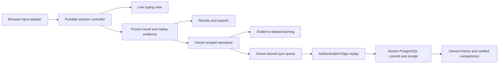
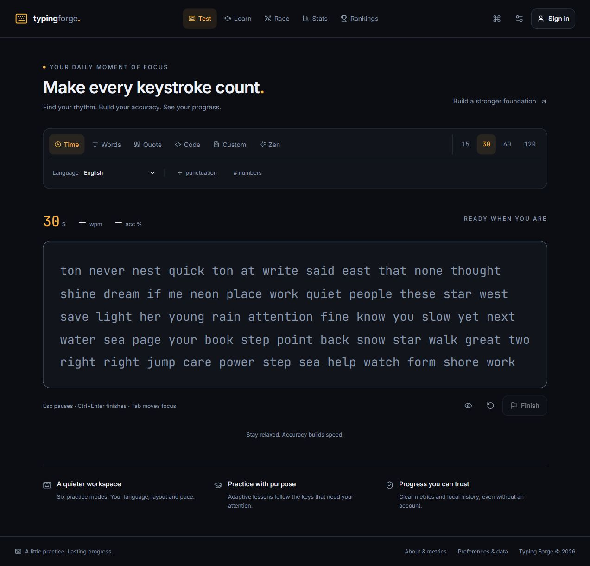

# Typing Forge v3 — implementation and verification

**Latest follow-up, 16 October:** the typing workspace now follows the reference interaction patterns studied in [Monkeytype and Keybr](COMPETITOR_ACCURACY_RESEARCH_2026-10-15.md#12-typing-experience-follow-up--16-october-2026). The verification checkpoint below covers this update. The earlier [visible wrong-key feedback](WRONG_KEY_FEEDBACK_2026-10-16.md) remains in place: actual incorrect input, advancing Learn by default, and corrected/rejected mistakes retained in accuracy. Earlier checkpoints keep their original scope and failures.

Date: **15–16 October 2026, Asia/Calcutta**. This ledger includes the later accuracy/competitor/Keyboard Lab follow-up. The [accuracy upgrade report](ACCURACY_UPGRADE_2026-10-15.md) explains the supplied score and repaired defects; [primary-source research](COMPETITOR_ACCURACY_RESEARCH_2026-10-15.md) compares Monkeytype and Keybr. The [original audit](../CURRENT_PROJECT_AUDIT_2026-10-15.md) describes the pre-v3 code; the [35-finding resolution matrix](AUDIT_RESOLUTION_MATRIX.md) maps each finding to its current implementation, evidence and remaining acceptance checks.

The main upgrade is implemented and works locally: a rebuilt typing engine, adaptive learning, premium themes and results, durable personal history, and client/SQL/Edge implementations for validated cloud sessions and human races. **This does not mean every item in the master specification is complete or the existing hosted backend has been upgraded.** No remote migration, Edge deployment, publication, commit or push was performed.

Existing user changes were preserved in [the baseline patch](../audit/implementation-baseline/user-working-tree.patch). All implementation changes remain reviewable in the working tree.

**Current release status: local review available; release verification remains open.** Browser results and repaired interaction defects are recorded separately below. Intermittent WebKit delays, a Firefox tracing/teardown failure, cloud deployment, native input and accessibility acceptance remain explicit gates; no percentage guarantee of universal correctness is claimed.

## Implemented behavior

### Quick retry checkpoint — 16 October

Tab → Enter now starts a fresh random-word local bot race from the typing field: ordinary Tab focuses the native Restart button and Enter activates it. Each retry changes the keyed session identity, producing a new UUID-seeded passage, empty input/history, a fresh 30-second clock and a new bot runner. Difficulty is retained. Interrupted local attempts are discarded consistently with Test; completed results retain their own saved identities.

Test and local-bot results opt into a focused results panel. From that panel, Tab focuses Next test and Enter activates it. Bot Next test now starts another bot race directly; Leave race returns to the lobby. The handler is scoped to the results panel itself, so child controls and Shift+Tab keep ordinary navigation. Explicit retries restore input focus even on touch devices using a physical keyboard; initial touch activation remains deliberate.

Human-room passage/timing/rematch authority remains on the server. A live human race does not acquire a unilateral local random-word reset. Code Tab indentation and custom-passage input retain their existing explicit policies.

A paused-clock regression test exposed a real initial-marker defect: the opponent marker's child layout effect could run before the parent's viewport/passage refs were attached, leaving the zero-position marker absent until the first bot tick. Its measurement now starts in a passive effect after those refs are attached. The test verifies the marker is visible at position zero without advancing the bot timer, then verifies later movement after advancing time.

Source checks: **494 unit tests / 31 files passed**; app/tooling/strict-domain/portable typechecks and production build passed; ESLint has 0 errors / 9 existing warnings. Initial practice JavaScript remains within budget at **197,062 gzip bytes**. Evidence and retained early diagnostics are in `audit/quick-restart-2026-10-16/`.

Final browser confirmation: **24/24 focused checks across Chromium, Firefox and WebKit** (five retry cases plus three race-pace cases per engine), zero failures/skips/flaky cases. Full Chromium suite: **79 passed / 2 cloud-environment skips / 0 failed**. The controlled-clock case verifies repeated fresh text/session IDs, cleared input/attempts, a full clock, opponent position zero before its next tick, preserved difficulty and first-character acceptance. Separate cases cover Test/bot results, native Shift+Tab and touch-device keyboard retries. See the [verification summary](../audit/quick-restart-2026-10-16/verification-summary.json), [three-engine report](../audit/quick-restart-2026-10-16/confirmation.json) and [full Chromium report](../audit/quick-restart-2026-10-16/chromium-final.json).

### Race opponent pace checkpoint — 16 October

The shared race passage now shows a light-gray opponent caret, a faint gray/dashed trail through still-untyped target characters and a compact legend with opponent WPM and characters ahead/behind. The user's amber caret, entered characters and red error feedback remain distinct. The opponent track uses the same gray. Paper and Forge Light use a darker neutral gray for visibility.

Local bots use their replayed canonical cursor, so hesitation and Backspace corrections affect the marker directly. Human rooms currently expose server-confirmed correct-character coverage rather than a live insertion cursor; their marker maps this coverage to the target grapheme count and is explicitly labelled **confirmed progress**. The UI does not extrapolate future movement from WPM. Server validation and scoring remain authoritative.

The marker never scrolls or writes input. It follows the existing user-controlled three-line viewport and remeasures after edits, wrapping, resize and font readiness. When an opponent is outside those lines, the ahead/behind legend remains visible. End-of-passage anchoring, clamped invalid values, reduced motion, accessible descriptions and cleanup are included. The personal preference pace caret is suppressed while a race opponent is shown.

Source verification: **494 unit tests / 31 files passed**, including 19 new pace-position vectors; all typecheck gates passed; ESLint 0 errors / 9 existing warnings; production build and bundle budget passed (**197,034 bytes** initial practice JavaScript gzip). Full Chromium suite: **74 passed / 2 cloud-environment skips / 0 failed**. Browser evidence is under `audit/race-pace-2026-10-16/`.

The first focused three-engine run passed 8/9. All caret, input-isolation and mobile-scroll assertions passed; the final WebKit cleanup case reached the existing “Loading your workspace…” delay after a hard navigation to Test and timed out before its input mounted. Its screenshot and trace remain in `engine-artifacts`. The cleanup case now follows the real navigation path: Leave race, assert the lobby, select Test from the mobile navigation, assert normal input and absence of race overlays. No timeout was increased, and the existing WebKit workspace-readiness release gate remains open.

The confirmation run passed **9/9 across Chromium, Firefox and WebKit**, with zero skips or flaky cases. See [verification summary](../audit/race-pace-2026-10-16/verification-summary.json), [race matrix](../audit/race-pace-2026-10-16/confirmation.json), and [full Chromium report](../audit/race-pace-2026-10-16/chromium.json). The live human-race runtime still requires dedicated deployment credentials; frontend progress conversion is covered by the pure helper vectors.

### Typing experience checkpoint — 16 October

- Test now centers a borderless three-line passage beneath compact controls. Whole prose words wrap together; code retains exact whitespace. A shared presentation renderer places extra letters beside the word being overtyped without changing canonical slot indexes or scoring.
- Desktop input starts focused while the timer remains ready. Touch users choose when to activate the keyboard. Blur keeps the same passage and input. Test restart follows ordinary Tab → Enter navigation; code indentation remains an explicit exception. Escape/pause policies remain Forge's own.
- Learn now stacks useful indicators, the passage, an optional logical keyboard and compact controls. Expected keys and actual wrong input are distinct. Detailed learning evidence remains available in an expandable section. Case folding applies only to the Latin keyboard tile; text and attempt evidence retain the actual case.
- Carets remeasure after edits, wrapping, resizing and font readiness, including extra input that leaves the canonical cursor unchanged. Long free writing follows its measured end caret. Learn input and Resume controls sit outside the scrolling passage. Explicit Pause focuses Resume and brings the passage into view, including when mobile controls were reached by scrolling. IME composition keeps control of Escape and other candidate-selection keys.
- Actual wrong letters and expected hints remain visible. Corrected mistakes still affect attempt accuracy. Metric version, formulas, result schema, ownership and cloud contracts are unchanged by this presentation update.

Final source checks: **475 unit tests across 30 files passed**, app/tooling/strict-domain/portable typechecks passed, ESLint **0 errors / 9 existing Fast Refresh warnings**, production build passed. Initial practice JavaScript is **196,089 gzip bytes**, below the 200,000-byte gate; the largest feature chunk is 108,519 gzip bytes. Vite's existing large-root-chunk and mixed quote-import advisories remain visible in the build log.

Browser outcomes and screenshots: `audit/typing-experience-2026-10-16/`. The new browser cases assert desktop/touch focus, three measured rows, whole-word wrapping, full-line rollover and backspace, resize/mobile width, blur persistence, Tab → Enter restart, extra letters beside their word, RTL caret visibility, long free writing, keyboard feedback/toggle, scrolled Learn pause/resume, same-cursor caret movement and IME Escape. These are automated browser checks; native IME and assistive-technology acceptance remain separate release gates.

**Final confirmation:** full Chromium suite **71 passed / 2 skipped / 0 failed**; focused experience and wrong-key matrix **57 passed / 0 skipped / 0 failed** across Chromium, Firefox and WebKit (19 per engine). The two skipped cases require dedicated deployed cloud-account credentials. See the [machine-readable verification summary](../audit/typing-experience-2026-10-16/verification-summary.json), [full Chromium report](../audit/typing-experience-2026-10-16/chromium-confirmation.json) and [three-engine report](../audit/typing-experience-2026-10-16/engines-confirmation.json). These runs cover the final production build, including the explicit pause/focus repair.

The first Chromium checkpoint passed 46 cases and failed one stale ambiguous RTL locator after an accessible passage description was added. The locator now targets the visible passage specifically. Review also reproduced the free-writing follow, paused-overlay clipping and same-cursor Learn caret issues; each was repaired and received a browser regression case. The first full Chromium run then passed 71 cases with 2 environment skips. The first focused cross-browser run passed 56/57 and exposed mobile WebKit scrolling the page down to Pause, leaving Resume above the visible page viewport. Pause now explicitly focuses Resume and centers the passage. The original failure log, screenshot and trace are retained alongside the subsequent confirmation runs.

| Area | Current result |
| --- | --- |
| Canonical core | One portable replayable controller supplies live metrics, frozen final results and persistence evidence. Timed scoring includes idle time and exact deadlines. Corrected/rejected mistakes stay in input accuracy. Retained raw speed and insertion-attempt rate are separate; insufficient evidence is null. |
| Practice and input | Time, Words, Quote, Code, Custom and Zen. Guided Zen and free writing are distinct. Selection replacement, deletion, Unicode graphemes and grouped composition are handled. Timed targets append without changing the issued prefix. Code preserves whitespace; Tab indentation is opt-in and assistance labelled. Pauses and repeated text affect comparison eligibility. |
| Adaptive learning | Six introduced English letters initially; recent evidence across multiple lessons controls mastery, and at most one letter is introduced per qualifying assessment. Actual mistakes guide practice. Ten original seeded language packs, six mapped keyboard layouts and an explicit native/unmapped reference. Ordinary tests/races can guide review without granting assessment mastery. |
| Design and preferences | Forge Dark/amber default, eight complete themes, self-hosted Inter/JetBrains Mono, responsive navigation, visible focus, reduced motion, command search and applied preferences. Routes and expensive results/chart/command modules load on demand. One root controller owns command open state and ignores held-key repeats/composition. |
| Results | WPM/accuracy hero, comparison-aware personal best, WPM/raw/error timeline and accessible table, actual numerator/denominator formulas, paginated canonical word-credit trace and recorded-edit seek/playback at 0.5×/1×/2×. Character/deletion accounting, real-data insights, key map, targeted practice, exact repeated retests, canonical JSON and statistics-only PNG exports. Final accuracy retains one display decimal when needed. |
| Precision and input exploration | Precision mode rejects incorrect characters without erasing their attempt cost. Keyboard Lab optionally requests the browser character map, offers manual layout references and observes focused key/code/release/repeat signals and measured transition drills. No hardware identity, switch or latency diagnosis is claimed. |
| Persistence and owner privacy | Owner-scoped IndexedDB, visible memory fallback, nondestructive legacy import, immutable identities, explicit guest import, deletion tombstones, expiring raw evidence and retained summaries. Upload states expose retries and authentication/validation failures. Custom/free-writing uploads require explicit consent. Account changes hide old history and reset unsaved private route state. Deletions bind the expected owner and captured bearer. |
| Backend source | Shared-core Edge replay, service-only atomic writes, idempotency receipts, protected aggregates, safe public handles, owner-bound ranked challenges, versioned preferences, account deletion and reconciliation. Six new migrations are included, fifteen total. |
| Races | Labelled local bots with injected clocks/randomness. Human races use server countdown/deadline, protected membership/state operations, persisted versions, polling/Realtime notification and replayed progress. Human runtime acceptance needs deployment. |
| Content and tooling | Twelve original passages and twenty complete original code examples with provenance/revisions. Updated npm toolchain, CI, strict domain gate, content checks, PostgreSQL/WASM migration assertions, coverage, audit and bundle budgets. |

Detailed contracts: [metrics](METRICS.md), [learning/content](LEARNING_AND_CONTENT.md), [decisions](DECISIONS.md), [data/deployment](DATA_AND_DEPLOYMENT.md).

## Architecture

The accepted cloud summary and original local candidate remain distinguishable. Legacy observations stay legacy/unverified; old aggregates do not pretend to reconstruct v3 keystroke evidence.

Target chronology is part of replay: later target extensions cannot retroactively improve earlier attempt accuracy. Public quote/code identity is included in the current comparison policy; private or unidentified fixed passages are isolated from cross-passage personal bests. Historical metric/cohort keys are not rewritten.

## Current follow-up verification

Evidence: [machine-readable summary](../audit/accuracy-research-2026-10-15/verification-summary.json), [conformance details](METRIC_CONFORMANCE_2026-10-15.md), [product route inventory](PRODUCT_VERIFICATION_2026-10-15.md) and [Keyboard Lab checks](KEYBOARD_LAB.md). Environment remains Windows, Node 22.20.0 and npm 11.8.0. Playwright 1.64.1 supplies Chromium, Firefox and WebKit; Windows WebKit does not certify Safari on Apple devices.

| Check | Follow-up result |
| --- | --- |
| TypeScript | Passed app/tooling checks and strict domain/portable configurations. The full React app still has `strict:false`. |
| ESLint | Passed: **0 errors / 9 existing Fast Refresh warnings**. Final touched-file check has zero errors/warnings. |
| Unit and domain coverage | **431 tests / 27 files passed**. Statements **89.72%**, branches **86.00%**, functions **90.09%**, lines **96.17%**, within the configured business-logic scope. React components and the whole application are not represented by that coverage percentage. |
| Independent conformance | **13,640 prose word vectors**, **15,000 randomized ASCII edits**, **5,000 randomized Unicode range edits**; shared server-forgery, timing, target-order and owner-boundary regressions. These are finite checks. |
| Production browsers — completed matrix | **149 passed / 6 cloud skips / 1 WebKit shortcut failure**, 156 cases, one worker, 6.5 minutes. Chromium and Firefox each passed 50; WebKit passed 49. This preceded the final controlled shortcut fix. Trace evidence identifies a premature shortcut press; readiness-only stress checks still found other stalls. |
| Current command/profile checks | After the held-shortcut fix: **11 passed / 1 Firefox context-teardown timeout**, 12 cases across three engines. All three command-repeat cases passed. The old static build demonstrably reopens on a repeat, failing the same regression. Tracing/teardown errors are not relabelled as passed tests. |
| Final current-build Chromium | **50 passed / 2 cloud skips / 0 failed**, 52 cases, 1.7 minutes. Includes the controlled shortcut repeat regression, owner-switch isolation, all new results features and the existing full local flow inventory. Saved as `chromium-current.txt` / `.json`. |
| Firefox diagnostic comparator | Guest-profile case: **1 passed / 0 failed**, 10.1 seconds total, with tracing disabled. Same build/assertions. This supports investigating tracing/teardown; it does not erase the earlier failure or change normal trace configuration. |
| Account privacy regression | The intercepted cross-tab account-switch test failed against the earlier build and passed with the guard in **all three engines** in the 156-case matrix; current Chromium also rechecked it. Fixture identities never reached a real service. |
| Database | **15 migrations**, integrity/owner-intent/matched-duration/one-use challenge assertions and legacy upgrade fixture passed under PGlite. This does not establish hosted transport or independent-connection concurrency. |
| Edge | All **3 entry points passed Deno checking**. No deployment or live HTTP verification was performed. |
| Content | All **20 original code examples passed** the syntax/planning checks described below. Browser finite completion now covers all five code languages through committed input adapters. |
| Dependencies | Full `npm audit --json`: **0 advisories**, including development dependencies. |
| Build and bundle | Production build and budgets passed: **194,923 bytes gzip** initial practice JS; **108,518** largest deferred feature; **20,954** CSS. Fonts are separate. The main minified chunk still exceeds Vite's 500 kB warning threshold. |

Earlier runs and failures are preserved: the pre-workspace-guard matrix had 142 passes/six skips/two WebKit failures. A readiness-only shortcut stress run had five passes/four failures, including one Firefox timeout. [The browser investigation](WEBKIT_VERIFICATION_2026-10-15.md) distinguishes these observations, the actual held-shortcut defect, and the final focused checks. The interrupted follow-up is incomplete evidence, not a passed run. A replay endpoint issue found during browser QA was repaired with a normalized integer slider so fractional elapsed times map exactly to the final position. No score tolerance, relaxed assertion or extended browser expectation timeout was introduced.

## Initial v3 verification — historical checkpoint

Environment: Windows, Node **22.20.0**, npm **11.8.0**, Chromium through Playwright. Evidence is retained under [audit/implementation-2026-10-15](../audit/implementation-2026-10-15).

| Check | Result |
| --- | --- |
| Clean install | `npm ci --no-fund --no-audit` passed: 353 packages. An initial Windows file lock was resolved by stopping this task's Vite processes before retrying. |
| TypeScript | `npm run typecheck` passed: app/Node checks, a separate strict domain gate for core/learning/content/history/repository/sync, and a portable-core pass without DOM or Node ambient types. The full React app does not yet use strict mode. |
| ESLint | **0 errors / 9 warnings**. Warnings concern mixed component/helper exports and Fast Refresh. |
| Units and scoped coverage | **334 tests / 23 files passed**. Statements **86.80%**, branches **81.35%**, functions **88.03%**, lines **95.00%**. Coverage covers the business-logic modules listed in `vitest.config.ts`, not the whole React application. Floors: 85% lines, 80% other dimensions. |
| Production browser suite | **31 passed / 2 skipped / 0 failed**, 33 total, **1.4 minutes** including browser teardown against the final static build. Account/race skips require dedicated cloud credentials. |
| Database compatibility | All **14 migrations** replayed from empty under PostgreSQL/WASM; integrity assertions and a separate legacy-upgrade fixture passed. Covers grants, ownership, identities, receipts/conflicts, preferences, deletion and explicit cleanup invocation. |
| Edge TypeScript | All three entry points passed `deno check` using Deno 2.9.6. This is module/type compatibility, not deployed HTTP execution. |
| Content | All **20 examples passed**: JavaScript parsing, TypeScript semantic compilation, Python AST, Rust metadata, SQLite EXPLAIN and PostgreSQL 18.6/PGlite 0.5.10 EXPLAIN for all four SQL exercises. No practice program was executed. |
| Dependencies | `npm audit --json`: **0 vulnerabilities**, including development dependencies. |
| Build | Production build passed. Vite still reports a main minified chunk over 500 kB. |
| Bundle | Initial practice import graph **192,655 bytes gzip** (<200,000); largest deferred feature **108,518 bytes gzip** (<150,000). CSS **20,049 bytes gzip**; fonts listed separately. These are not total downloaded bytes or field-performance results. |

Browser coverage includes corrected-mistake accuracy, single persistence, timed idle cutoff, code focus/opt-in indentation, composition, all ten packs, learning persistence, repeated retests, extended Zen targets, free-writing null target metrics, guest statistics, mobile navigation, preferences and local bots. It does not establish native OS IME behavior or full accessibility conformance.

The corrected-input browser regression also downloads and validates the real PNG signature and **1200 × 630** dimensions. The [share image](../audit/implementation-2026-10-15/result-share.png) and [full results screenshot](../audit/implementation-2026-10-15/results-desktop.png) were inspected visually. A floating-point chart tick was found and fixed by formatting its display label; underlying evidence precision is preserved.

## Milestones

| Milestone | Disposition |
| --- | --- |
| M0 Baseline/decisions | Complete locally; baseline, audit, specification and decisions retained. |
| M1 Canonical sessions/metrics | Main implementation and local regressions complete. |
| M2 Persistence/backend | Local persistence and backend source implemented; hosted acceptance pending. |
| M3 Learning/content | Main implementation and local checks complete; native input, editorial and cross-device acceptance pending. |
| M4 Race lifecycle | Bot practice verified; human implementation present, live multi-client acceptance pending. |
| M5 Design/preferences/results | Main upgrade complete; broader specification extras remain below. |
| M6 Accessibility/tooling/operations | Domain/tooling gates pass within their scopes; WebKit navigation, manual accessibility, field performance and live operations remain open. |
| M7 Release | **Pending**. No remote publication or promotion. |

## Remaining specification and release work

The [resolution matrix](AUDIT_RESOLUTION_MATRIX.md#remaining-master-prompt-requirements-and-differences) records the complete differences. Principal remaining items:

1. Deploy reviewed migrations/Edge functions to disposable/staging Supabase, regenerate types, test actual Auth/HTTP/RLS/Realtime, simultaneous clients, account deletion and cross-device reconciliation. Install cleanup schedules and observe real execution. PostgreSQL/WASM does not establish these outcomes.
2. Resolve the observed WebKit loading/navigation failures and validate actual Safari devices. Finish extended product features: custom/system themes, searchable/importable settings, shortcut remapping and requested defaults, more HUD/pace sources, public result-link UI, first-use onboarding and genuine daily/weekly ranking views. Word-detail and recorded-edit replay are implemented in the follow-up.
3. Complete native IME/mobile keyboard, language editorial, assistive-technology and zoom/reflow checks. Measure mobile Lighthouse/input latency and hosted performance. Build/bundle checks do not establish those results.
4. Continue toolchain maintenance: clean installation prints deprecation notices for the retained Recharts 2 and ESLint 9 branches. The current dependency audit has no advisories; major-version compatibility work remains separate from that scan.

The deployment guide includes operator steps and rollback considerations. Guest practice, local learning, results and history can be reviewed immediately without deploying the new backend.

